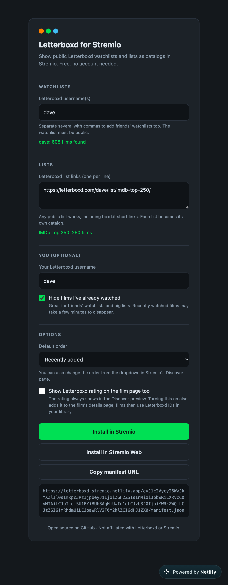

<div align="center">

# Letterboxd for Stremio

**Your Letterboxd watchlists and lists, right inside Stremio.**<br>
Free, open source, no account or API key needed.

[](https://letterboxd-stremio.netlify.app/configure)

[](https://letterboxd-stremio.netlify.app)
[](LICENSE)


[English](#features) · [Türkçe](#türkçe)



</div>

## Features

- **Any public watchlist.** Yours, your friends', anyone's — just type the username. Add several, each gets its own catalog.
- **Letterboxd lists.** Paste any public list link (or a `boxd.it` short link) and it becomes a catalog — IMDb Top 250, a friend's horror list, festival line-ups…
- **Hide what you've watched.** Enter your own username and films you've already logged disappear from every catalog. Perfect for picking a movie night film from a friend's watchlist.
- **Letterboxd ratings.** Each film shows its Letterboxd average (e.g. `★ 4.5 on Letterboxd`) in Stremio's Discover preview, and optionally on the film page too.
- **Works with your other addons.** Films come back with IMDb IDs, so Cinemeta and every stream addon you have work as usual.
- **Sorting.** Recently added / list order, reverse, title, release year (newest / oldest), daily shuffle. Change it any time from the dropdown on Stremio's Discover page.
- **5 languages.** English, Türkçe, Español, Français and 中文 (Mandarin). The configure page picks your browser language, and catalog names, sort options and ratings in Stremio follow your choice. Film titles and descriptions come from Letterboxd / Cinemeta.
- **Fast & private.** CDN-cached responses, no database, no accounts, no tracking. Your settings live only in your own install URL.

## Install

1. Open **[letterboxd-stremio.netlify.app](https://letterboxd-stremio.netlify.app/configure)**.
2. Add a username for watchlists and/or paste list links (they must be public).
3. Optional: enter your own username and tick **Hide films I've already watched**.
4. Click **Install in Stremio** (desktop / mobile app) or **Install in Stremio Web**.

The catalog shows up on Stremio's **Board** and **Discover** pages.

## How it works

```
Browser ──► /configure            pick username(s) + sort order
                │
                ▼
https://…/<base64url settings>/manifest.json   ◄── installed in Stremio
                │
Stremio ──► /<settings>/catalog/movie/lbxd-watchlist-<user>.json
           /<settings>/catalog/movie/lbxd-list-<user>~<slug>.json
                │
                ├─ letterboxd.com/<user>/watchlist/page/N/   all pages, cached 15 min
                ├─ letterboxd.com/<user>/list/<slug>/page/N/ all pages, cached 15 min
                ├─ letterboxd.com/film/<slug>/               IMDb ID, poster, rating; cached 30 days
                └─ letterboxd.com/<me>/film/<slug>/          200 = watched, 404 = not (hide-watched)
```

- **Stateless.** The server stores nothing about users, so one free instance can serve everyone.
- **Gradual resolution.** Each request resolves up to N film pages within a time budget (Netlify's free plan has a 10 s limit). Anything not resolved yet is returned as `lbxd:<slug>`; the addon's own `meta` endpoint resolves it on open and passes the IMDb ID to stream addons via `defaultVideoId`. Remaining pages are warmed up in the background.
- **Hide watched.** Letterboxd blocks bots from paging through a user's full `/films/` grid, so the addon seeds the watched set from `/films/` page 1 and the diary RSS, then checks remaining films one by one (`/<me>/film/<slug>/`). "Watched" is cached for 30 days, "not watched" for 6 hours. Known-watched films are removed before paging so `skip` stays consistent.
- **Local sorting.** Letterboxd's sorted URLs (`/by/release/` …) are blocked for bots, so the list is fetched once and sorted inside the addon.

| File | Purpose |
|---|---|
| [`src/addon.js`](src/addon.js) | Platform-independent core: manifest, catalog, meta, routing |
| [`src/letterboxd.js`](src/letterboxd.js) | Watchlist and film page parsing |
| [`src/cache.js`](src/cache.js) | In-memory LRU (+ Cache API on Workers) |
| [`src/configure.js`](src/configure.js) | Configure page with language picker |
| [`src/i18n.js`](src/i18n.js) | Translations (en, tr, es, fr, zh) — add a language here |
| [`netlify/functions/addon.js`](netlify/functions/addon.js) | Netlify adapter |
| [`src/server.js`](src/server.js) | Plain Node server (local, Render, Koyeb, Docker…) |
| [`src/worker.js`](src/worker.js) | Cloudflare Workers adapter (experimental) |

## Self-hosting

Want your own instance? It's free.

[](https://app.netlify.com/start/deploy?repository=https://github.com/harunsahinol/letterboxd-stremio)

**Netlify (recommended):** click the button above, or fork the repo and import it at [app.netlify.com](https://app.netlify.com). No build settings needed — everything is in [`netlify.toml`](netlify.toml).

**Locally:**

```bash
npm start
```

Then open <http://localhost:7001/configure>. (Port 7000 is avoided because macOS AirPlay uses it.) Quick smoke test against live Letterboxd:

```bash
npm test -- your_username
```

**Docker / Render / Koyeb / Railway:** start command `npm start`, or use the included [`Dockerfile`](Dockerfile). Note that Render's free plan sleeps after 15 minutes of inactivity.

**Cloudflare Workers (experimental):** `npx wrangler deploy`. The free plan's 50-subrequest limit means large watchlists fill in over a few refreshes.

## Limitations

- Watchlists and lists must be **public**.
- Hide-watched checks films gradually; on a big list the first load may still show a few watched films, which disappear on the next refresh. Letterboxd's official API isn't open to the public, so private lists can't be read.
- Rare films with no IMDb link on Letterboxd show up as `lbxd:` items; they open with Letterboxd info but may have no streams.
- Film titles and plot summaries are not translated (they come from Letterboxd / Cinemeta in English). Translation fixes and new languages are welcome in [`src/i18n.js`](src/i18n.js).
- If Letterboxd changes its HTML, `parseWatchlistPage` / `parseFilmPage` in `src/letterboxd.js` need updating. Issues and PRs are welcome.

---

## Türkçe

Herhangi bir **herkese açık** Letterboxd watchlist'ini Stremio'da katalog olarak gösteren, ücretsiz ve açık kaynak eklenti.

<div align="center"></div>

### Kurulum

1. **[letterboxd-stremio.netlify.app](https://letterboxd-stremio.netlify.app/configure)** adresini aç.
2. Watchlist için kullanıcı adı yaz ve/veya liste bağlantılarını yapıştır (herkese açık olmalılar).
3. İstersen kendi kullanıcı adını girip **İzlediğim filmleri gizle**'yi işaretle.
4. **Stremio'ya yükle** ya da **Stremio Web'e yükle** butonuna bas.

### Özellikler

- Hesap, veritabanı, API anahtarı yok. Ayarların sadece kendi kurulum adresinde durur.
- Virgülle ayırarak birden fazla kullanıcı ekleyebilirsin; arkadaşlarının watchlist'leri ayrı katalog olarak gelir.
- **Letterboxd listeleri:** Herhangi bir herkese açık liste bağlantısını (boxd.it dahil) yapıştır, ayrı bir katalog olsun.
- **İzlediklerimi gizle:** Kendi kullanıcı adını girersen izlediğin filmler tüm kataloglardan kaybolur. Arkadaşının listesinden film seçerken birebir.
- **5 dil:** İngilizce, Türkçe, İspanyolca, Fransızca ve Çince (Mandarin). Kurulum sayfası tarayıcı dilini seçer; Stremio'daki katalog adları, sıralama seçenekleri ve puanlar da seçtiğin dilde gelir. Film adları ve açıklamaları Letterboxd/Cinemeta'dan gelir.
- **Letterboxd puanı:** Her film Keşfet önizlemesinde Letterboxd ortalamasıyla görünür (ör. `★ 4.5 on Letterboxd`); istersen film sayfasında da.
- Filmler IMDb ID'leriyle döner, yani Cinemeta ve kurulu tüm stream eklentileri normal çalışır.
- Sıralama: son eklenen, ilk eklenen, isim, çıkış yılı (yeni/eski), günlük karışık. Stremio'nun Keşfet sayfasındaki menüden de değiştirilebilir.

### Kendi sunucunda çalıştırma

Yukarıdaki **Deploy to Netlify** butonuna bas ya da repoyu fork'layıp [app.netlify.com](https://app.netlify.com)'da içe aktar; ek ayar gerekmez. Yerelde `npm start` ile çalıştırıp <http://localhost:7001/configure> adresini aç.

### Sınırlar

- Watchlist herkese açık olmalı; gizli listeler okunamaz.
- Letterboxd'da IMDb bağlantısı olmayan nadir filmler `lbxd:` ID'siyle görünür ve stream bulunamayabilir.

---

<sub>Not affiliated with Letterboxd or Stremio. Cache times are intentionally long to be gentle on Letterboxd. · MIT License</sub>
