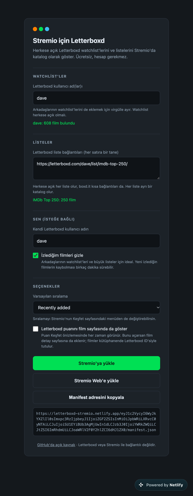

<div align="center">

# Letterboxd for Stremio

**Your Letterboxd watchlists, lists and diaries — right inside Stremio.**<br>
Free and open source. No account, no password, no API key.

<a href="https://letterboxd-stremio.netlify.app/configure"></a>

[](https://letterboxd-stremio.netlify.app) [](LICENSE)  

**English** · [Türkçe](#türkçe)


</div>

---

## Features

### Catalogs

- 👤 **Watchlists** — yours, your friends', anyone's. Just type usernames; each becomes its own catalog.
- 📋 **Lists** — paste any public list link (or a `boxd.it` short link): IMDb Top 250, a friend's horror list, festival line-ups…
- 📖 **Diaries** — each user's recently watched films, with their stars, ♥ and watch date.

### Finding something to watch

- 🎭 **Genre filter** — pick Horror, Animation, Drama… from the dropdown on Stremio's Discover page, in any catalog.
- 👁 **Hide what you've watched** — enter your own username and films you've already logged disappear everywhere. Perfect for movie night from a friend's watchlist.
- ↕ **Sorting** — recently added / list order, reverse, title, release year, or a daily shuffle.
- ★ **Letterboxd ratings** — every film shows its Letterboxd average in the Discover preview, and optionally on the film page too.

### Everything else

- 🌍 **5 languages** — English, Türkçe, Español, Français, 中文. Catalog names, menus and ratings follow your choice.
- 🔌 **Plays nicely with your other addons** — films use IMDb IDs, so Cinemeta and your stream addons just work.
- 🔒 **Private by design** — no accounts and no personal data. Your settings live only in your own install link. The public site keeps only anonymous daily totals, which anyone can see at [/stats](https://letterboxd-stremio.netlify.app/stats).
- 🆓 **Free forever** — MIT licensed, and anyone can run their own copy for free in one click.

## Install

1. Open **[letterboxd-stremio.netlify.app](https://letterboxd-stremio.netlify.app/configure)**.
2. **What should appear in Stremio?** Type usernames for watchlists (tick *Also add their diaries* if you like) and/or paste list links.
3. **Personalize** *(optional)*: your own username to hide films you've watched, default order, rating on the film page.
4. Check the summary of catalogs you'll get, then click **Install in Stremio** (or **Stremio Web**).

Your catalogs appear on Stremio's **Board** and **Discover** pages. To change settings later, open the addon's ⚙ *Configure* button in Stremio, adjust, and install again.

## Good to know

- **Watchlists, lists and diaries must be public.** Letterboxd's official API isn't open to the public, so private data can't be read.
- **Diaries show the last 50 entries** — that's what Letterboxd's RSS feed provides.
- **Sort and genre share one menu.** Stremio shows a single dropdown per catalog, so sort options (marked `↕`) come first, then genres. Picking a genre uses your default order.
- **Big lists fill in gradually.** On the very first load, a genre filter or *hide watched* may show only part of the result; the rest appears after a refresh or two while the addon warms its cache.
- **Film titles and plots stay in English** (they come from Letterboxd / Cinemeta). The addon's own text is translated.
- **A few rare films have no IMDb link** on Letterboxd. They show up with Letterboxd info but may have no streams.

## Run your own copy

It's free and takes about a minute.

[](https://app.netlify.com/start/deploy?repository=https://github.com/harunsahinol/letterboxd-stremio)

- **Netlify (recommended)** — click the button, or fork and import at [app.netlify.com](https://app.netlify.com). No settings needed; everything is in [`netlify.toml`](netlify.toml).
- **Your computer** — needs Node.js 18+:

  ```bash
  npm start
  ```

  Then open <http://localhost:7001/configure>. (Port 7000 is skipped because macOS AirPlay uses it.)
- **Docker / Render / Koyeb / Railway** — start command `npm start`, or use the [`Dockerfile`](Dockerfile). Render's free plan sleeps after 15 minutes idle.
- **Cloudflare Workers** *(experimental)* — `npx wrangler deploy`. The free plan's subrequest limit means big lists fill in more slowly.

Smoke test against live Letterboxd:

```bash
npm test -- your_username
```

<details>
<summary><b>How it works</b> (for developers)</summary>

<br>

```
Browser ──► /configure                       choose catalogs + options
                │
                ▼
https://…/<base64url settings>/manifest.json   ◄── installed in Stremio
                │
Stremio ──► /<settings>/catalog/movie/lbxd-watchlist-<user>.json
           /<settings>/catalog/movie/lbxd-diary-<user>.json
           /<settings>/catalog/movie/lbxd-list-<user>~<slug>.json
                │
                ├─ letterboxd.com/<user>/watchlist/page/N/    every page, cached 15 min
                ├─ letterboxd.com/<user>/list/<slug>/page/N/  every page, cached 15 min
                ├─ letterboxd.com/<user>/rss/                 diary (last 50), cached 15 min
                ├─ letterboxd.com/film/<slug>/                IMDb ID, poster, rating, genres — 30 days
                └─ letterboxd.com/<me>/film/<slug>/           200 = watched, 404 = not
```

- **Stateless.** Settings are base64url JSON in the install URL, so the server stores nothing and one free instance serves everyone.
- **Gradual resolution.** Each request resolves film pages within a budget and deadline (Netlify's free plan stops functions at 10 s). Unresolved films are returned as `lbxd:<slug>`; the addon's `meta` endpoint resolves them on open and hands the IMDb ID to stream addons via `defaultVideoId`. Upcoming pages are warmed in the background.
- **Hide watched.** Letterboxd blocks bots from paging a user's full `/films/` grid, so the watched set is seeded from `/films/` page 1 plus the diary RSS, then checked per film. "Watched" is cached 30 days, "not watched" 6 hours. Known matches are removed before paging so `skip` stays consistent.
- **Genre filter.** Genres are parsed from the film page already fetched for the IMDb ID. Films known to be in another genre are dropped before paging; unknown ones are checked within the request budget.
- **Local sorting.** Letterboxd's sorted URLs (`/by/release/`…) are blocked for bots, so lists are fetched once and sorted inside the addon.
- **Caching.** In-memory LRU plus Netlify's durable CDN cache. Film data is shared across all users, so popular films are almost never fetched twice.

| File | Purpose |
|---|---|
| [`src/addon.js`](src/addon.js) | Platform-independent core: manifest, catalogs, meta, routing |
| [`src/letterboxd.js`](src/letterboxd.js) | Watchlist, list, diary and film page parsing |
| [`src/configure.js`](src/configure.js) | Configure page |
| [`src/i18n.js`](src/i18n.js) | All translations — add or fix a language here |
| [`src/cache.js`](src/cache.js) | In-memory LRU (+ Cache API on Workers) |
| [`netlify/functions/addon.js`](netlify/functions/addon.js) | Netlify adapter |
| [`src/stats.js`](src/stats.js), [`netlify/stats-store.js`](netlify/stats-store.js) | Anonymous daily totals and the `/stats` page. Off unless `STATS_SECRET` is set, so your own copy counts nothing by default. |
| [`src/server.js`](src/server.js) | Plain Node server |
| [`src/worker.js`](src/worker.js) | Cloudflare Workers adapter |

</details>

## Contributing

Issues and pull requests are welcome — especially:

- **Translations.** Spotted an awkward phrase, or want your language? Everything is in [`src/i18n.js`](src/i18n.js).
- **Letterboxd changes.** If catalogs suddenly come back empty, Letterboxd probably changed its HTML; the parsers live in [`src/letterboxd.js`](src/letterboxd.js).

---

## Türkçe

Letterboxd watchlist'lerini, listelerini ve günlüklerini Stremio'da katalog olarak gösteren eklenti. Ücretsiz ve açık kaynak; hesap, şifre ya da API anahtarı gerekmez.

<div align="center"></div>

### Özellikler

- 👤 **Watchlist'ler** — Kendi, arkadaşlarının ya da herhangi birinin; kullanıcı adını yazman yeterli. Her biri ayrı katalog olur.
- 📋 **Listeler** — Herkese açık herhangi bir liste bağlantısını (boxd.it dahil) yapıştır: IMDb Top 250, arkadaşının korku listesi, festival seçkileri…
- 📖 **Günlükler** — Her kullanıcının son izlediği filmler; verdiği yıldızlar, ♥ ve izleme tarihiyle.
- 🎭 **Tür filtresi** — Stremio'nun Keşfet sayfasındaki menüden Korku, Animasyon, Dram… seç; her katalogda çalışır.
- 👁 **İzlediklerimi gizle** — Kendi kullanıcı adını girersen izlediğin filmler her yerden kaybolur. Arkadaşının listesinden film gecesi seçmek için birebir.
- ↕ **Sıralama** — Son eklenen / liste sırası, ters sıra, isim, çıkış yılı ya da günlük karışık.
- ★ **Letterboxd puanı** — Her film Keşfet önizlemesinde Letterboxd ortalamasıyla görünür; istersen film sayfasında da.
- 🌍 **5 dil** — İngilizce, Türkçe, İspanyolca, Fransızca, Çince. Katalog adları, menüler ve puanlar seçtiğin dilde gelir.
- 🔌 Filmler IMDb ID'siyle döner; Cinemeta ve stream eklentilerin olduğu gibi çalışır.
- 🔒 Hesap ve kişisel veri yok. Ayarların sadece kendi kurulum bağlantında durur. Herkese açık sitede yalnızca isimsiz günlük toplamlar tutulur; bunları herkes [/stats](https://letterboxd-stremio.netlify.app/stats) sayfasında görebilir.

### Kurulum

1. **[letterboxd-stremio.netlify.app](https://letterboxd-stremio.netlify.app/configure)** adresini aç.
2. **Stremio'da ne görünsün?** Watchlist için kullanıcı adlarını yaz (istersen *Günlüklerini de ekle*'yi işaretle) ve/veya liste bağlantılarını yapıştır.
3. **Kişiselleştir** *(isteğe bağlı)*: izlediklerini gizlemek için kendi kullanıcı adın, varsayılan sıralama, film sayfasında puan.
4. Eklenecek katalogların özetine bak, **Stremio'ya yükle**'ye (ya da **Stremio Web**'e) bas.

Kataloglar Stremio'nun **Board** ve **Keşfet** ekranlarında görünür. Ayarları sonra değiştirmek için Stremio'da eklentinin ⚙ *Configure* (Yapılandır) butonuna bas, düzenle ve yeniden yükle.

### Bilmen gerekenler

- **Watchlist, liste ve günlükler herkese açık olmalı.** Letterboxd'un resmî API'si genel kullanıma kapalı, gizli veriler okunamaz.
- **Günlükte son 50 kayıt görünür**; Letterboxd'un RSS akışı bu kadarını veriyor.
- **Sıralama ve tür aynı menüde.** Stremio her katalogda tek açılır menü gösteriyor; önce `↕` işaretli sıralamalar, sonra türler gelir. Tür seçince varsayılan sıralaman kullanılır.
- **Büyük listeler kademeli dolar.** İlk açılışta tür filtresi ya da *izlediklerimi gizle* sonucun bir kısmını gösterebilir; kalanı bir iki yenilemede gelir.
- **Film adları ve özetleri İngilizce kalır** (Letterboxd/Cinemeta'dan gelir). Eklentinin kendi metinleri çevrilidir.
- **IMDb bağlantısı olmayan nadir filmler** Letterboxd bilgileriyle görünür ama stream bulunamayabilir.

### Kendi kopyanı çalıştır

Yukarıdaki **Deploy to Netlify** butonuna bas ya da repoyu fork'layıp [app.netlify.com](https://app.netlify.com)'da içe aktar; ek ayar gerekmez. Kendi bilgisayarında `npm start` ile çalıştırıp <http://localhost:7001/configure> adresini aç.

### Katkı

Hata bildirimi ve pull request'ler açık; özellikle çeviri düzeltmeleri ve yeni diller ([`src/i18n.js`](src/i18n.js)).

---

<div align="center"><sub>Not affiliated with Letterboxd or Stremio. Cache times are intentionally long to be gentle on Letterboxd. · <a href="LICENSE">MIT License</a></sub></div>
